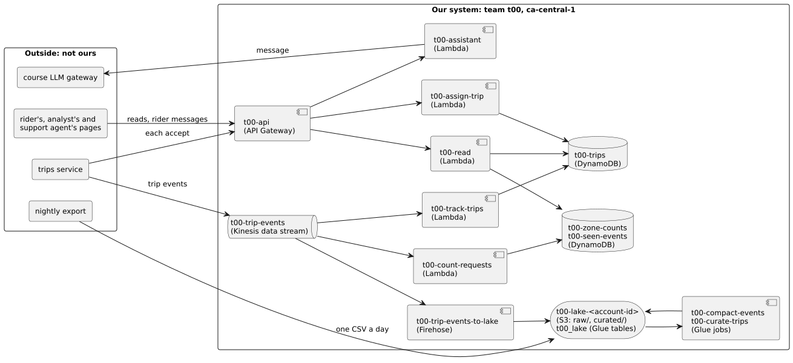

# Design

Team t00, the rides case. Sections Workflows and Sketch were sections 4 and 5 of the proposal.

## Sketch

Source: [sketch.puml](sketch.puml) (PlantUML). Every box is a row in [Resources](#resources), or in the table of what
is outside our system.

## Workflows

Each workflow names the IDs it serves in brackets after its name, and the components it uses; every component is a row in
[Resources](#resources).

### Counting requests [R010, R020, RF010, RF020]

The trips service sends each trip event to the stream. The counting function counts requests by pickup zone in
5-minute periods and stores each count within 60 s of the period's end (p95); a late request corrects the count of its
period. It writes each request's id and its count in one DynamoDB transaction, so an event delivered twice, or a
batch that Lambda sends again after a failure, is counted once; a record that fails is reported by its sequence
number, and Lambda sends the batch again from it, at most 3 times ([review](reviews/well-architected.md), question 1; PR #6).

Components: `t00-trip-events`, `t00-count-requests`, `t00-zone-counts`, `t00-seen-events`

### Assigning trips [R070, R080, R090, R100, RF030]

The tracking function keeps each trip current from the stream. A driver's accept comes to the API as one request;
the assign function makes one conditional write, so only one of two accepts for a trip is answered `assigned`,
within 2 s (p99).

Components: `t00-trip-events`, `t00-track-trips`, `t00-api`, `t00-assign-trip`, `t00-trips`

### Reading counts and trips [R030, R090, R100, RF020]

The read function answers the rider's and the analyst's pages through the API. A zone and period without a count
is shown as no data, not as 0.

Components: `t00-api`, `t00-read`, `t00-zone-counts`, `t00-trips`

### Lake and nightly jobs [R040, R050, RF040]

Firehose writes the stream to the bucket about once a minute, and at 00:30 UTC the compaction job rewrites the day
before as one Parquet file. The curation job loads the nightly export's completed trips with a fare above 0 within
30 minutes of the file's arrival (p95) and sets the other rows aside.

Components: `t00-trip-events-to-lake`, `t00-lake-<account-id>`, `t00_lake`, `t00-compact-events`,
`trip_events_compacted`, `t00-curate-trips`, `trips_curated`, `trips_rejected`

### Pickup place of a message [R110, R120]

The support agent's page sends a rider's message through the API to the assistant function. The function sends it
to the model through the course LLM gateway as the user message, with our list of places in the system prompt and
the output format a JSON object with one field, `pickup_place`. The function shows the value if it is a name on the
list, `null`, or `"more than one"` when the message names more than one pickup place; any other reply is shown as no
answer.

Components: `t00-api`, `t00-assistant`

## Resources

Every resource is in ca-central-1, has a name that starts with `t00-` (the Glue database is `t00_lake`, and its tables
are named without the prefix), and carries the tags `Project=436c`, `Team=t00`, `Owner=course` (RF050). At
Checkpoint 2 the counting path of JS01 is deployed: the first six rows, created by `scripts/stream.py up` and
`scripts/counting.py up`, and deleted by `scripts/teardown.sh --yes`, the stream first. They exist only for a run or
a demo; between runs nothing is kept. The other rows are planned: their scripts, and their lines in
`scripts/teardown.sh`, come with them for the final hand-in (PR #3).

| Resource | Name | Created by | IDs |
|---|---|---|---|
| Kinesis data stream, provisioned, 1 shard (PR #6) | `t00-trip-events` | `scripts/stream.py up` | R010, R020, RF010, RF050 |
| Lambda function, Python 3.12 on arm64, 128 MB, at most 1 run at a time | `t00-count-requests` | `scripts/counting.py up` | R010, R020, RF010, RF020, RF050 |
| Lambda event source mapping, batches of up to 100 records or 1 s, 3 retries | `t00-trip-events` to `t00-count-requests` | `scripts/counting.py up` | R010, R020, RF010 |
| DynamoDB table, on demand, key `zone_id`, `period_start` | `t00-zone-counts` | `scripts/counting.py up` | R010, R020, R030, RF020, RF050 |
| DynamoDB table, on demand, key `event_id`, items expire after 24 hours | `t00-seen-events` | `scripts/counting.py up` | RF010, RF050 |
| CloudWatch log group, kept 7 days | `/aws/lambda/t00-count-requests` | `scripts/counting.py up` | RF050 |
| IAM role of the counting function: read the stream, write the two tables and its log group | `t00-count-requests-fn` | the course staff (not deleted by our scripts; a role costs nothing) | RF050 |
| Lambda function | `t00-track-trips` | planned: `scripts/assignment.py up` | R070, R090, R100, RF050 |
| Lambda function | `t00-assign-trip` | planned: `scripts/assignment.py up` | R070, R080, RF030, RF050 |
| DynamoDB table | `t00-trips` | planned: `scripts/assignment.py up` | R070, R080, R090, R100, RF030, RF050 |
| API Gateway HTTP API | `t00-api` | planned: `scripts/api.py up` | R030, R070, R080, R090, R100, R110, R120, RF050 |
| Lambda function | `t00-read` | planned: `scripts/api.py up` | R030, R090, R100, RF020, RF050 |
| Firehose stream | `t00-trip-events-to-lake` | planned: `scripts/lake.py up` | RF040, RF050 |
| S3 bucket | `t00-lake-<account-id>` | planned: `scripts/lake.py up` | R040, R050, RF040, RF050 |
| Glue database | `t00_lake` | planned: `scripts/lake.py up` | R040, R050, RF040, RF050 |
| Glue table, in `t00_lake` | `trips_curated` | planned: `scripts/curate.py up` | R040, R050, RF050 |
| Glue table, in `t00_lake` | `trips_rejected` | planned: `scripts/curate.py up` | R050, RF050 |
| Glue job | `t00-curate-trips` | planned: `scripts/curate.py up` | R040, R050, RF050 |
| Glue table, in `t00_lake` | `trip_events_compacted` | planned: `scripts/compact.py up` | RF040, RF050 |
| Glue job, run every night at 00:30 UTC | `t00-compact-events` | planned: `scripts/compact.py up` | RF040, RF050 |
| Lambda function (the assistant) | `t00-assistant` | planned: `scripts/assistant.py up` | R110, R120, RF050 |

What the deployed slice costs while nobody uses it: the stream's shard, 0.0165 USD an hour, 11.88 USD for 30 days
(price sheet, ca-central-1, 2026-11-18); the tables and the log group bill only what they store (a few kilobytes
after a run), and the function and its mapping only when records arrive. So the stream is created for a run and
deleted after it ([Decisions](requirements.md#decisions)).

Outside our system. We do not create these; our system relies on what the last column says.

| Who | Sends | To | What we rely on |
|---|---|---|---|
| the app's trips service | each trip event | stream `t00-trip-events` | one JSON object with the event fields of Data; an event may arrive twice or late; an event is not sent again more than 24 hours after it was first sent (Q030) |
| the app's trips service | each accept, as one request | API `t00-api` | the body holds `event_id`, `trip_id`, `driver_id` and `event_time`; the app passes our answer to the driver's phone |
| the app's nightly export | one CSV file with the day's completed trips | `raw/trip-exports/dt=<day>/` in our bucket | the columns are the fields of `trip_completed`; the file arrives by 05:30 UTC |
| the rider's page, the analyst's browser and the support agent's page | reads and rider messages | API `t00-api` | none |
| the course LLM gateway | the model's reply to each message | function `t00-assistant` | the team's keys share one pool of 7.25 CAD (5 USD); 120 requests a minute per key |

## Cost

RQ010 (PR #7): one year of the system, in CAD, at the course price sheet's rates (ca-central-1, 2026-11-18; 1.45 CAD a
USD, the rate the sheet uses), the free tier left out. `uv run python scripts/year_cost.py` writes the table.

**Volume.** DS01 has 6,045,943 completed trips in March 2024 (*measured*, Data), 195,030 a day; with one request for
each completed trip (Q050, *assumed*) that is 71.2 million requests a year and, with three events a trip, 213.6
million events on the stream, about 6.8 a second.

**Units of work.** For the deployed counting path the units come from the run on AWS (`evidence/units.json`,
`scripts/run_units.py`): a counted request uses 4 DynamoDB write units (a transaction of 2 items, 2 units each); a run
of the function is billed 9.3 ms plus 8.8 ms for each record (fitted on the replays at 10 and 50 times SIM01's speed);
a run logs 444 bytes. Lambda reads a shard about once a second ([Lambda and Kinesis, polling and batching
streams](https://docs.aws.amazon.com/lambda/latest/dg/with-kinesis.html)), so at 6.8 events a second we count one run
a second. For the parts not built yet, the units are *assumed*, row by row.

| Part | Units a year | Rate (USD) | USD a year | Where the units come from |
|---|---|---|---|---|
| **Counting path, deployed** (units measured on AWS) | | | | |
| Kinesis stream, 1 shard | 8,760.00 shard-hours | 0.0165 per shard-hour | 144.54 | 1 shard for the whole year |
| Kinesis PUT payload units | 213.56 million units | 0.0154 per million | 3.29 | 3 events a trip, each under 25 KB |
| Lambda requests | 31.54 million runs | 0.2 per million | 6.31 | assumed: one run a second (Lambda polls a shard once a second) at 6.8 events a second |
| Lambda duration, arm64, 128 MB | 271,852.35 GB-seconds | 0.0000133334 per GB-second | 3.62 | measured: 9.3 ms a run + 8.8 ms a record = 69 ms |
| DynamoDB writes, counting | 284.74 million write units | 0.6875 per million | 195.76 | measured: 4 write units a request (a transaction of 2 items) |
| CloudWatch Logs, counting function | 14.00 GB | 0.55 per GB | 7.70 | measured: 444 bytes a run |
| **The rest of the design, not built yet** (units assumed) | | | | |
| Athena, the 30-day count | 0.91 TB scanned | 5.5 per TB | 5.02 | assumed: 50 queries a day, 50 MB each |
| Firehose to the lake | 53.39 GB | 0.032 per GB | 1.71 | assumed: 250 bytes an event |
| S3 storage, raw and compacted | 320.34 GB-months | 0.025 per GB-month | 8.01 | assumed: half a year's events on average |
| S3 PUTs from Firehose | 525.60 thousand requests | 0.0055 per thousand | 2.89 | one file a minute |
| Glue jobs, compaction and curation | 121.67 DPU-hours | 0.308 per DPU-hour | 37.47 | assumed: 2 jobs a night, 2 DPUs, 5 minutes |
| DynamoDB writes, trips | 142.37 million write units | 0.6875 per million | 97.88 | assumed: 2 writes a trip (assign, complete) |
| API Gateway HTTP API | 142.37 million requests | 1.11 per million | 158.03 | assumed: an accept and a rider's read a trip |
| Lambda requests, assign and read functions | 142.37 million runs | 0.2 per million | 28.47 | assumed: one run for each API request |
| Lambda duration, assign and read functions | 889,826.29 GB-seconds | 0.0000133334 per GB-second | 11.86 | assumed: 50 ms at 128 MB a run |
| Course LLM gateway, the assistant | 0.07 million requests | 44.1379 per million | 3.22 | assumed (Q040): 200 messages a day, 600 input and 20 output tokens each, qwen3.8-27b at 0.10 and 0.20 CAD per million tokens |

**One year: about 524 CAD for the counting path, and 1,038 CAD for the whole design** (361 and 716 USD). The largest
lines are the counting path's DynamoDB writes (195.76 USD), doubled by the transaction of [review](reviews/well-architected.md) question
1, the API's requests (158.03 USD, assumed) and the stream's shard (144.54 USD), billed every hour of the year.
Without the transaction the counting writes would cost half as much (2 units a request), with the risk that question
describes.

**The run of 2026-11-26** (`evidence/units.json`): the stream existed 1.45 hours in all (05:50 to 07:15 and 07:15 to
07:17 UTC, the second time for the redeploy of step 6.4 of the page); 11,499 records went into it, the function ran
2,116 times for 135.2 billed seconds at 128 MB, the two tables used 20,156 write and 22,527 read units (the examples'
and the replays' reads and clears included), and the log group received 0.94 MB. At the price sheet's rates that is
**0.0422 USD = 0.0612 CAD**: the shard 0.0239, the writes 0.0139, the reads 0.0031, everything else 0.0013 USD
(`evidence/units.txt`, `evidence/units-recost.txt`). The few records of the redeploy's one example came after the
units were read and are not in them. Cost Explorer was not read: the bill of the course staff's account holds other
work, and the price sheet asks for the cost from the units.

## Experiments

RQ020 (PR #7): R010's data latency against the replay speed. `sim/replay_test.py` replays SIM01's deliveries received
up to 10:11 (2,332 of its 2,515; every request and both late ones) through the deployed slice, at 1, 10 and 50 times
SIM01's speed, with the course replayer (`sim/replay.py`). Each run starts from empty tables and waits until every
request is counted. R010's data latency of a zone and period is the time from the moment the replay reaches the
period's end to the moment the stored count holds every request received by then (0 when it held them before the end);
R020's, from the moment a late request was sent to its corrected count. Run on 2026-11-26, one run at each speed; the
files are in `evidence/rq020-x1/`, `rq020-x10/` and `rq020-x50/` (`report.json`, and `seen.jsonl` with the two times
of each request).

| Speed (times SIM01's) | Replay | Deliveries | R010 data latency, 36 zones and periods: median / p95 / max (s) | R020, the 2 late requests: median / p95 / max (s) | Each request, sent to counted: median / p95 / max (s) | Function runs, records a run | Billed ms a run | Trips 09:00 to 10:00, zones 48, 161, 230 (truth 304, 191, 342) |
|---|---|---|---|---|---|---|---|---|
| 1 | 70.4 min | 2332 | 0.00 / 0.91 / 1.94 | 0.85 / 1.05 / 1.05 | 0.94 / 1.96 / 2.04 | 1556, 1.5 | 19 | 304, 191, 342 (match) |
| 10 | 7.0 min | 2332 | 0.00 / 0.98 / 1.01 | 0.39 / 0.55 / 0.55 | 0.66 / 1.09 / 1.94 | 420, 5.5 | 58 | 304, 191, 342 (match) |
| 50 | 1.4 min | 2332 | 0.60 / 0.70 / 0.70 | 0.52 / 1.04 / 1.04 | 0.70 / 1.00 / 1.10 | 86, 27.1 | 248 | 304, 191, 342 (match) |

**Result.** R010's data latency stays under 1 s at p95 at all three speeds (0.91, 0.98 and 0.70 s at 1, 10 and 50
times the speed), far inside its target of 60 s, and the counts match SIM01's truth at each speed. The latency does
not grow with the speed because Lambda reads the shard about once a second ([Lambda and
Kinesis](https://docs.aws.amazon.com/lambda/latest/dg/with-kinesis.html)): a request waits for the next read and one
batch, whatever the rate. What grows is the batch: 1.5 records a run at 1 times the speed, 5.5 at 10 and 27.1 at 50. A
run takes about 9 ms plus 8.8 ms a record, so, estimated from that fit and not measured, one shard read by one run at
a time keeps up to about 112 records a second, 204 times SIM01's speed and 17 times the rate of the whole DS01 subset
(6.8 events a second); above that, the latency would grow with the backlog. At 50 times the speed the median is higher
than at 1 and 10 times because a period's last request arrives a fraction of a second before the period ends, so its
count is stored just after the end. Observed once, not explained by these runs: the first batch after the deploy took
28 s from the stream to the count (`evidence/first-batch.txt`); in the replays every request was counted within 2.1 s
of being sent.

## Data

### Our data

DS01 is the High Volume For-Hire Vehicle trip records of the NYC Taxi and Limousine Commission: one row for each
finished trip, one [Parquet file a month](https://d37ci6vzurychx.cloudfront.net/trip-data/fhvhv_tripdata_2024-03.parquet)
over HTTPS ([trip record page](https://www.nyc.gov/site/tlc/about/tlc-trip-record-data.page)). We use the Uber trips
picked up in Manhattan in March 2024 (*our choice*): 6,045,943 of the month's 21,280,788 rows, 0.20 GB as Parquet
(*measured* 2026-11-19, DuckDB). DS02, the TLC [taxi zone lookup](https://d37ci6vzurychx.cloudfront.net/misc/taxi_zone_lookup.csv),
gives the borough and name of each of its 265 zones (*measured* 2026-11-20, DuckDB). The system's events are simulated
from DS01 rows of zones 48, 161 and 230 (*our choice*); each bullet below says which days of DS01 it uses and the
dates they are moved to (*our choice*).

### Simulated data for the demos

- **SIM01 Rush hour** [RF010] One morning hour from DS01: the 837 trips requested in zones 48, 161 and 230 on
  2024-03-14 between 08:00 and 09:00 New York time, moved to 09:00 to 10:00 UTC on 2026-11-23: 304, 191 and 342
  trips, 2,511 events sent as 2,515 deliveries: 4 requests arrive twice, and 2 arrive 6 to 10 minutes late.
- **SIM02 Quiet zone** [RF020] SIM01's hour from DS01 without its 6 faults, and without the 60 trips of zone 48
  requested between 09:25 and 09:35: 777 trips (244, 191 and 342 in zones 48, 161 and 230), 2,331 events.
- **SIM03 Double accept** [R080, RF030] The first 20 trips of zone 161 in SIM01's hour from DS01, at the same times:
  60 events, 20 requests and 40 accepts. Each trip is accepted by two drivers at the same moment; for 10 of the 20
  trips the later accept is first in the file.
- **SIM04 Trips day** [R040] One day's file of completed trips from DS01: the 19,074 trips requested in the three
  zones on 2024-03-14 (*measured* 2026-11-20, DuckDB), moved to 2026-11-22, and 3 rows added with a bad fare: 1
  without a fare, 1 with a fare of 0 and 1 with a negative fare. 19,077 rows.
- **SIM05 Thirty days** [RF040] 30 days of requests from DS01: the 524,629 trips requested in the three zones from
  2024-03-01 to 2024-03-30 (142,310, 188,010 and 194,309 in zones 48, 161 and 230, *measured* 2026-11-20, DuckDB),
  moved to 2026-10-24 to 2026-11-22, one `trip_requested` event each, as one small file for each minute of receipt:
  42,797 files. The minute and the pickup zone of each request come from DS01; its second, rider, dropoff zone and
  quoted fare are made up (*our choice*). It does not have injected faults. (PR #5)

**Event format** (each delivery also has `received_time`, set when the event arrives; the field types are the Pydantic
models of `src/rides/events.py`, every time in UTC written like `2026-11-23T09:00:00Z`; PR #5):

- `trip_requested`: `event_id`, `trip_id`, `rider_id`, `pickup_zone_id`, `dropoff_zone_id`, `quoted_fare`, `event_time`
- `trip_accepted`: `event_id`, `trip_id`, `driver_id`, `event_time` (also the body of an accept sent to the API)
- `trip_completed`: `event_id`, `trip_id`, `driver_id`, `dropoff_zone_id`, `trip_miles`, `trip_time_s`, `fare`,
  `driver_pay`, `event_time`; a row of the nightly export has the same fields without `event_id` (SIM04)

From a DS01 row come the request time, the pickup and dropoff zones, `trip_miles`, `trip_time_s`, `fare` (also the
request's `quoted_fare`) and `driver_pay`. DS01 does not have riders, drivers or accepts, so the generator makes up
the rest (*our choice*): `event_id`, `trip_id`, `rider_id` and `driver_id`; the accept 3 to 15 s after the request;
the completion 5 minutes plus the trip time after the accept; and `received_time`, 1 s after the event unless a
bullet says otherwise. The rider messages of R110 and R120 are written by the team.
